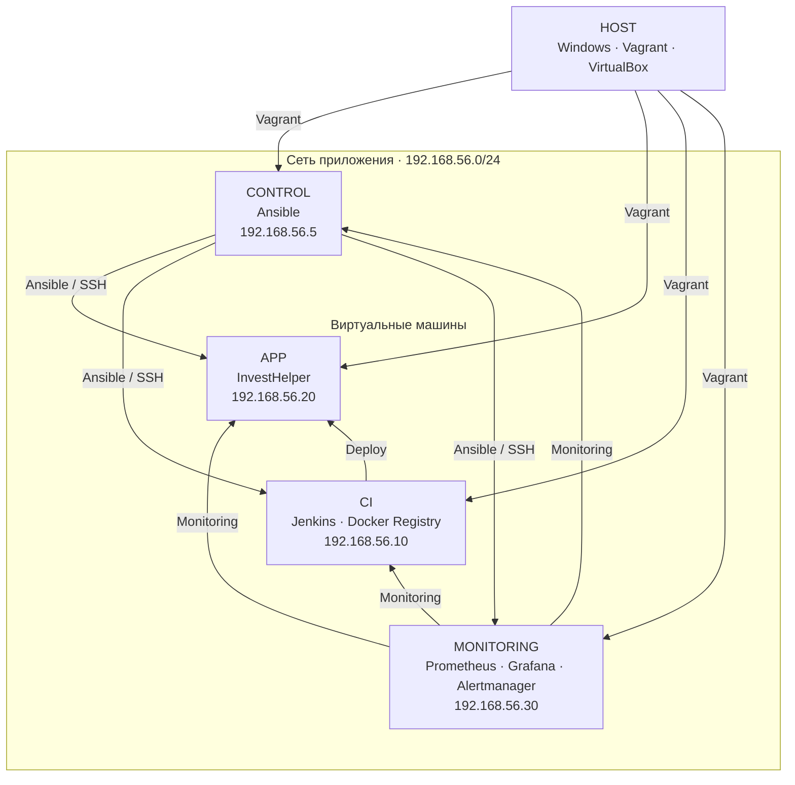

# InvestHelper Infrastructure

Воспроизводимое локальное окружение для сборки, развёртывания и эксплуатации
[InvestHelper](https://github.com/VBaltser/InvestHelper).
Проект управляет виртуальными машинами, CI/CD, хранилищем контейнерных образов
и мониторингом через конфигурацию в Git.

Vagrant и VirtualBox создают машины и сеть. Ansible устанавливает и настраивает
сервисы. Jenkins проверяет изменения приложения и доставляет их на сервер.

## Возможности

- Создание и настройка окружения одной командой после подготовки секретов.
- Разделение управления, сборки, приложения и мониторинга по отдельным VM.
- CI для веток приложения и автоматический деплой основной ветки.
- Хранение Docker-образов в локальном Registry.
- Уведомления о результатах CI/CD в Telegram.
- Сбор метрик, проверка HTTP-доступности и алерты.
- Поддержка Ansible Vault и автоматическая настройка Jenkins Credentials.

## Архитектура

| Узел         | Адрес           | Ресурсы          | Назначение                                           |
| ------------ | --------------- | ---------------- | ---------------------------------------------------- |
| `control`    | `192.168.56.5`  | 1 vCPU, 1 ГБ RAM | Управляющий узел Ansible                             |
| `ci`         | `192.168.56.10` | 2 vCPU, 4 ГБ RAM | Jenkins, Docker Registry, сборка и тестирование      |
| `app`        | `192.168.56.20` | 2 vCPU, 3 ГБ RAM | Приложение в Docker Compose                          |
| `monitoring` | `192.168.56.30` | 2 vCPU, 3 ГБ RAM | Prometheus, Grafana, Alertmanager, Blackbox Exporter |



Все VM используют Ubuntu `ubuntu/jammy64` и два сетевых интерфейса:
NAT для исходящего доступа в интернет и host-only сеть `192.168.56.0/24`
для внутренних соединений и доступа с Windows.

Ansible работает на `control`; устанавливать его на Windows не требуется.
Node Exporter установлен на всех VM, cAdvisor — на `ci`, `app`, `monitoring`.

## Требования

- Windows с PowerShell, VirtualBox и Vagrant.
- OpenSSH Client, включая `ssh`, `scp` и `ssh-keygen`.
- Аппаратная виртуализация AMD-V/VT-x.
- Не менее 11 ГБ RAM для VM сверх памяти, необходимой хостовой ОС.
- Свободная подсеть `192.168.56.0/24` без конфликтов с VPN.
- Доступ к GitHub, репозиториям пакетов, контейнерным registry и внешним API.

Проект рассчитан на локальную сеть: веб-сервисы и Registry доступны по HTTP,
Registry не требует аутентификации. Для публичного размещения потребуется
отдельная настройка защиты и сетевого доступа.

## Быстрый запуск

Все команды выполняются в PowerShell из корня репозитория.

### 1. Подготовить конфигурацию

```powershell
New-Item -ItemType Directory -Path .secrets -Force
Copy-Item bootstrap.example.yml .secrets/bootstrap.yml
notepad .secrets/bootstrap.yml
```

Заполните обязательные значения:

| Переменная               | Назначение                              |
| ------------------------ | --------------------------------------- |
| `jenkins_admin_password` | Пароль администратора Jenkins           |
| `grafana_admin_password` | Начальный пароль администратора Grafana |
| `tinkoff_token`          | Токен доступа к T-Invest API            |
| `telegram_bot_token`     | Токен Telegram-бота                     |
| `telegram_chat_id`       | ID чата для результатов CI/CD           |

Бот должен быть добавлен в чат с правом отправки сообщений.
`telegram_chat_id` указывайте строкой в кавычках, сохраняя знак минус.
Ключи `gemini_api_key` и `groq_api_key` необязательны.

Каталог `.secrets/` исключён из Git. Шаблон `bootstrap.example.yml` не должен
содержать рабочие значения. Общие параметры сети и адрес репозитория приложения
находятся в `ansible/inventory/group_vars/all.yml`.

### 2. Запустить окружение

```powershell
.\up.ps1
```

Скрипт проверяет входные файлы, поднимает рабочие VM, затем `control` и запускает
Ansible. Настраиваются приложение, Jenkins, Registry, credentials и мониторинг.
Повторный запуск применяет конфигурацию к существующим VM, не удаляя их диски.

Для другого файла конфигурации:

```powershell
.\up.ps1 -SecretsFile C:\Secure\investhelper-bootstrap.yml
```

### 3. Первый pipeline

При создании Jenkins job начинается сканирование репозитория приложения.
Первый pipeline основной ветки собирает, тестирует и развёртывает образы.
Завершение `up.ps1` не означает завершение этой асинхронной сборки.
В основной ветке приложения должен находиться актуальный Jenkinsfile.

## Адреса сервисов

| Сервис              | URL                             |
| ------------------- | ------------------------------- |
| Jenkins             | <http://192.168.56.10:8080/>    |
| Docker Registry API | <http://192.168.56.10:5000/v2/> |
| Приложение prod     | <http://192.168.56.20:8080/>    |
| Приложение staging  | <http://192.168.56.20:8082/>    |
| Grafana             | <http://192.168.56.30:3000/>    |
| Prometheus          | <http://192.168.56.30:9090/>    |
| Alertmanager        | <http://192.168.56.30:9093/>    |

Логин Jenkins и Grafana по умолчанию — `admin`; пароли берутся из bootstrap-файла.
Registry предоставляет API без веб-интерфейса. Список образов доступен по
`/v2/_catalog`, теги — по `/v2/<repository>/tags/list`.

## Секреты и Ansible Vault

Bootstrap поддерживает открытый YAML и файл, целиком зашифрованный Ansible Vault.
Для постоянного хранения рекомендуется Vault.

Пользовательский файл пароля должен быть доступен только владельцу; скрипт его
не удаляет. Созданные скриптом временные файлы пароля удаляются после выполнения.
Для редактирования Vault используется `ansible-vault edit`.

Секреты передаются playbook через `--extra-vars` и переопределяют заглушки inventory.
Без bootstrap-переменных применятся заглушки.

## Доставка приложения

Multibranch job Jenkins сканирует GitHub раз в минуту. Для каждой ветки
с Jenkinsfile выполняются линтеры, сборка, HTTP-тесты собранного приложения
и публикация образов и артефактов.

После успешного CI ветки `main` Jenkins запускает SSH-деплой на `app`.
Helper `deploy-investhelper` загружает образы, обновляет контейнеры и проверяет
их готовность. Деплоится проверенный образ с уникальным тегом сборки.

| Параметр Jenkins                 | Значение по умолчанию |
| -------------------------------- | --------------------- |
| `APP_VERSION` — префикс тега     | `1.0.0`               |
| `DEPLOY_ENV` — целевое окружение | `prod`                |

Результаты отправляются в Telegram. Сообщение содержит итог pipeline
и отдельный статус деплоя. Ошибка доставки сообщения отмечается в console log.

### Окружения

| Окружение | Compose project        | Порт |
| --------- | ---------------------- | ---: |
| prod      | `investhelper`         | 8080 |
| staging   | `investhelper-staging` | 8082 |

Окружения имеют отдельные контейнеры и сети, но используют одну VM и общий `.env`.

TLS к T-Invest проверяется с отдельным набором доверенных CA, включающим
Russian Trusted Root/Sub CA. Путь передаётся через `TINKOFF_SSL_CA_FILE`.

Для ручного деплоя или возврата к опубликованному тегу подключитесь к `app`:

```powershell
vagrant ssh app
```

Выполните на VM:

```bash
deploy-investhelper <image-tag> prod
# Или:
deploy-investhelper <image-tag> staging
```

Последний успешный тег сохраняется в `/opt/investhelper/.deploy-prod.env`
или `.deploy-staging.env`.

## Наблюдаемость

Prometheus опрашивает Node Exporter, cAdvisor, Jenkins и Blackbox Exporter
каждые 15 секунд. Grafana получает datasource Prometheus автоматически.

HTTP probe проверяет prod frontend `/health`.

| Правило                   | Условие                                  | Задержка |
| ------------------------- | ---------------------------------------- | -------- |
| `TargetDown`              | `up == 0`                                | 2 минуты |
| `InvestHelperUnavailable` | `probe_success{job="investhelper"} == 0` | 1 минута |

Prometheus передаёт активные алерты в Alertmanager. Внешняя доставка алертов
из Alertmanager не настроена и не связана с Telegram-уведомлениями Jenkins.

Проверить доступность приложения можно запросом:

```promql
probe_success{job="investhelper"}
```

`1` означает успешную проверку, `0` — отказ

## Эксплуатация

Команды Windows из корня репозитория:

```powershell
vagrant status                       # состояние VM
vagrant ssh app                      # подключение к app
vagrant ssh ci                       # подключение к ci
vagrant ssh monitoring               # подключение к monitoring
vagrant halt                         # остановка с сохранением дисков
vagrant up --no-provision             # запуск уже настроенного окружения
.\up.ps1                             # повторное применение конфигурации
vagrant reload app --no-provision     # перезагрузка одной VM
```

Базовые HTTP-проверки после деплоя:

```powershell
curl.exe --noproxy "*" http://192.168.56.10:5000/v2/
curl.exe --noproxy "*" http://192.168.56.20:8080/health
curl.exe --noproxy "*" http://192.168.56.20:8080/api/health
```

Журналы внутри соответствующих VM:

```bash
# ci
sudo journalctl -u jenkins -n 100 --no-pager

# app
docker logs --tail 100 investhelper-backend-1

# monitoring
docker compose -f /opt/monitoring/compose.yml logs --tail 100 prometheus
```

`vagrant destroy` удаляет VM и данные на их дисках, включая Jenkins, Registry
и Docker volumes. Перед пересозданием сохраните необходимые данные и секреты

## Структура репозитория

```text
Vagrantfile                 описание VM и базовый provisioning
up.ps1                      запуск и передача bootstrap-конфигурации
bootstrap.example.yml       шаблон секретов
ansible/
  inventory/                группы VM и общие параметры
  playbooks/bootstrap.yml   проверка входных переменных
  playbooks/site.yml        конфигурация всех узлов
  roles/                    роли сервисов и системных компонентов
.secrets/                   локальные секреты, исключены из Git
.vagrant/                   состояние VM и ключи, исключены из Git
```
